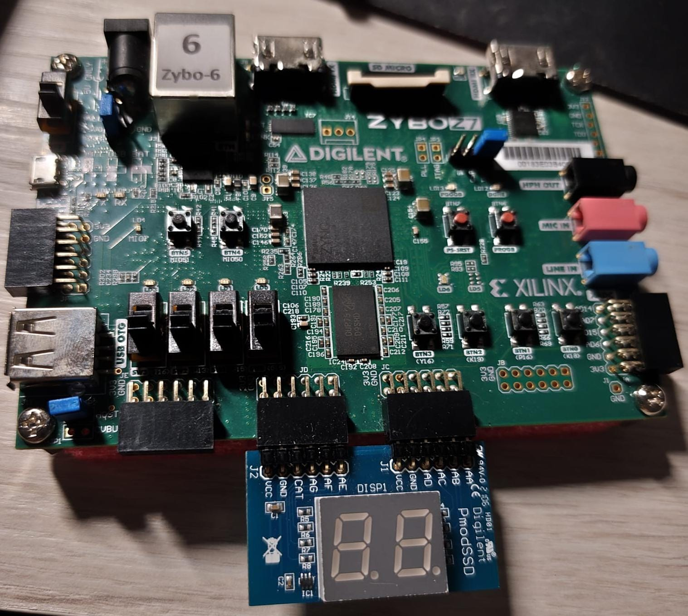
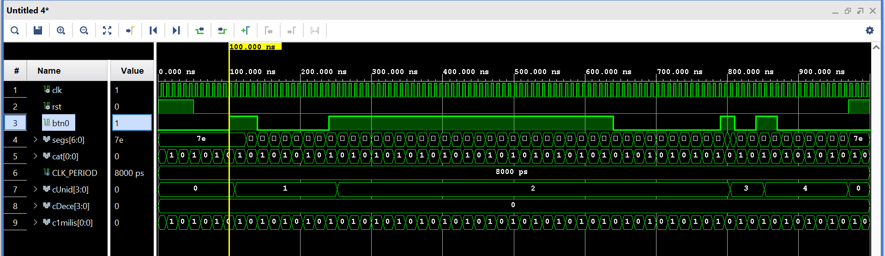

# 2-Digit BCD Counter with Multiplexed 7-Segment Display

Digital counter implemented in VHDL on the Digilent Zybo Z7-10 (Xilinx Zynq-7000) using a Digilent Pmod SSD display.

## Functionality
* **Count Control:** Pressing `BTN0` increments the counter by 1.
* **Range:** Counts in dual BCD format from `00` to `99`, rolling over back to `00`.
* **Reset:** Pressing `BTN1` resets both BCD counters immediately to `00`.
* **Multiplexing:** Employs a 1 ms refresh rate to switch between digits without visible flicker.

## Hardware Mapping
* **Board:** Digilent Zybo Z7-10
* **Clock:** 125 MHz onboard oscillator
* **Inputs:** `BTN0` (count enable), `BTN1` (system reset)
* **Outputs:** Pmod SSD connected to headers `JC` (segments A-D) and `JD` (segments E-G and cathode selector)

## Hardware Setup & Demo

