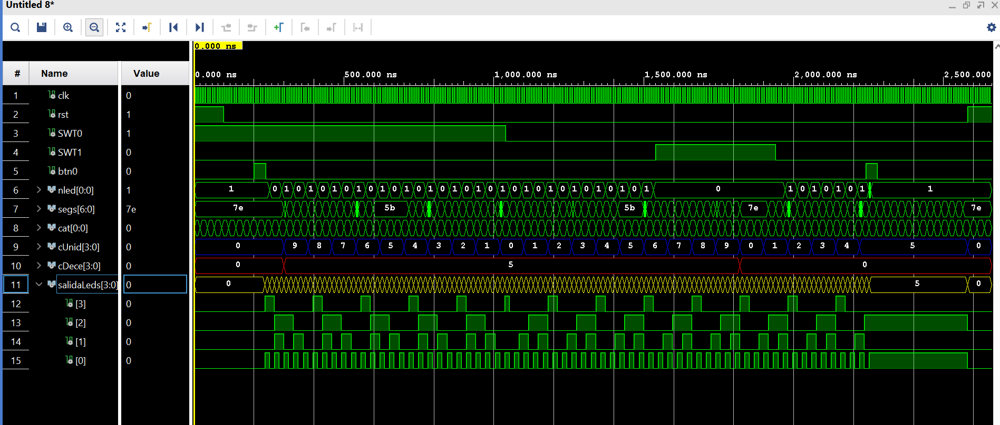

# ⏱️ Advanced Bidirectional Stopwatch in VHDL (Practice 1 - Advanced 2)

**Author:** Marco Antonio Amodeo Galan  
**Institution:** Universidad Rey Juan Carlos (URJC)  
**Area:** Digital Design / Electronic Systems  

---

## 📝 Project Description

This repository contains the VHDL source code and physical constraints (XDC) for implementing an **advanced bidirectional digital stopwatch** on a **Zybo Z7** FPGA board (Xilinx Zynq-7000). 

The system displays seconds (00 to 59) on a 7-segment Pmod SSD display using **time-multiplexing** techniques, while managing visual indicators for tenths of a second and half-second intervals on the board's integrated LEDs. The design applies principles of modular hierarchical architecture, frequency dividers, simple state machines (Flip-Flops), and real-hardware mitigation techniques (debouncing).

## ✨ Key Features

* **Bidirectional Modulo-60 Counting:** Counts from 00 to 59 (seconds). Fully supports logical wrap-around (overflow 59->00 and underflow 00->59).
* **Direction Control:** Dynamic selection between up-counting and down-counting via a physical switch (`SWT0`).
* **Run / Pause with Debouncing:** A single push button (`btn0`) toggles between pausing and resuming the timer. Implemented using a dual-stage shift register for edge detection and a T Flip-Flop.
* **1 kHz Multiplexed Display:** Displays tens and units on a 7-segment display sharing a single data bus, utilizing visual persistence (POV).
* **Tenths Monitoring:** 4 individual LEDs display the tenths of a second count (0 to 9) in binary format.
* **"Heartbeat" Indicator (Half-second):** An RGB LED blinks at an exact 1 Hz frequency (0.5s ON, 0.5s OFF).
* **"Lights-Out" Mode (Kill-Switch):** A control switch (`SWT1`) forces all physical indicator LEDs to turn off, while keeping the internal background counting fully intact.

---

## 🏗️ System Architecture (VHDL Modules)

The project is designed following a strictly modular and structural approach (`top_practica1_avanzada2.vhd`):

| Module | Description |
| :--- | :--- |
| `top_practica1_avanzada2.vhd` | **Top-Level:** Instantiates all sub-modules and manages signal routing. |
| `conta_1s.vhd` | Frequency divider generating an exact 1-second tick pulse. |
| `cuentaDecimas.vhd` | Timebase generator (0.1s) for tenths counting. |
| `conta_halfs.vhd` | Timebase for RGB LED blinking (0.5s high / 0.5s low). |
| `conta_milis.vhd` | High-speed clock (~1 kHz) for display multiplexing. |
| `conta_bcd.vhd` | Bidirectional Modulo-10 BCD counter (Units and tenths, 0-9). |
| `conta_bcd1.vhd` | Bidirectional Modulo-6 BCD counter (Tens, 0-5). |
| `bcd_7seg.vhd` | Combinational BCD to 7-segment display decoder. |
| `det_flanco.vhd` | Debouncer / Edge Detector using a Shift Register. |
| `flipflpT.vhd` | T Flip-Flop to memorize the run/pause state. |
| `top_practica1_avanzada2_TB.vhd`| **Testbench:** Simulation environment to verify underflow, pause, and light control. |

---

## 🛠️ Hardware Used

* **Development Board:** Digilent Zybo Z7 (Zynq-7000 ARM/FPGA SoC).
* **External Display:** Pmod SSD (Seven Segment Display) connected via GPIO headers.
* **System Clock:** 125 MHz.
* **Development Environment:** AMD Xilinx Vivado.

---

## 📌 Input/Output (I/O) Mapping

| Peripheral | Physical Pin (Zybo Z7) | VHDL Port Name | Function |
| :--- | :--- | :--- | :--- |
| **Clock** | `K17` | `clk` | Master Clock (125 MHz) |
| **Button 0** | `P16` | `rst` | Asynchronous System Reset |
| **Button 1** | `K18` | `btn0` | Run / Pause Toggle Button |
| **Switch 0** | `G15` | `SWT0` | Direction (Down = Up-count, Up = Down-count) |
| **Switch 1** | `P15` | `SWT1` | Kill-switch (0 = ON, 1 = OFF) |
| **RGB LED 6** | `F17` | `nled[0]` | 0.5-second Heartbeat Blink |
| **LEDs [3:0]** | `D18,G14,M15,M14`| `leds[3:0]` | Tenths count in binary |
| **Pmod SSD** | Multiple | `segs[6:0], cat[0]`| Maps to 7-segments and common cathode |

---
## 🔬 Simulation & Verification

To ensure the logical correctness of the design before hardware synthesis, a comprehensive testbench (`top_practica1_avanzada2_TB.vhd`) was developed. The behavioral simulation verifies critical edge cases and system stability, including:

* **Modulo-60 Underflow/Overflow:** Seamless transitions between `00` and `59` when changing directions.
* **Debouncer & Pause Logic:** Accurate toggle state retention without mechanical bouncing artifacts.
* **Kill-Switch Activation:** Verification that `SWT1` disables physical outputs while maintaining the internal counting state.



> **🎥 Hardware Demo:** Check out the physical implementation working on the Zybo Z7 board in the `advanced_counterVIDEO.mp4` file included in this repository.
## 🚀 How to Run the Project

1. Clone this repository:
   ```bash
   git clone [https://github.com/YourUsername/vhdl-advanced-stopwatch-zybo.git](https://github.com/YourUsername/vhdl-advanced-stopwatch-zybo.git)
  
   
